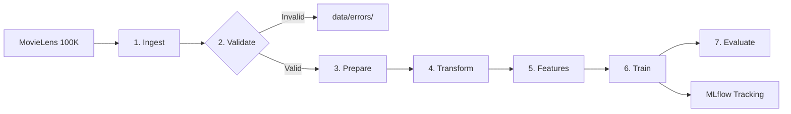

# End-to-End Recommendation System Pipeline

**Course:** Data Management for Machine Learning (DMML) — Assignment 2  
**Student ID:** 2025AG05929  
**Repository:** https://github.com/RushikeshKothawade07/2025AG05929_DMML_Assignment2  
**Dataset:** MovieLens 100K (943 users, 1,682 items, 100,000 interactions)  

---

## 1. Pipeline Architecture



---

## 2. Project Structure

```
2025AG05929_DMML_Assignment2/
├── configs/
│   └── config.yaml                     # Pipeline configuration
├── dags/
│   └── recommendation_pipeline_dag.py  # Apache Airflow DAG
├── data/
│   ├── raw/                            # Ingested MovieLens CSV files
│   ├── errors/                         # Quarantined invalid records
│   ├── processed/                      # Cleaned and split Parquet files
│   └── features/                       # Reusable feature tables
├── models/                             # Saved model artifacts (.pkl)
├── reports/                            # Reports and evaluation metrics
│   ├── data_validation_report.md       # Validation log
│   ├── feature_catalog.md              # Feature dictionary table
│   ├── evaluation_results.md           # Model comparison table
│   └── model_comparison.csv            # Quantitative metrics
├── src/
│   ├── ingestion/ingest.py             # Stage 1: Data ingestion
│   ├── validation/validate.py          # Stage 2: Quality validation
│   ├── preparation/prepare.py          # Stage 3: Chronological 80/20 split
│   ├── transformation/transform.py      # Stage 4: Summaries and CSR matrix
│   ├── features/feature_store.py       # Stage 5: Feature engineering
│   ├── training/                       # Stage 6: Training (Popularity & Funk-SVD)
│   ├── evaluation/                     # Stage 7: Evaluation metrics
│   └── utils.py                        # Common helper functions
├── requirements.txt                    # Python dependencies
├── run_pipeline.py                     # Master pipeline execution script
└── README.md
```

---

## 3. Setup & Execution

### 1. Setup Virtual Environment
```bash
git clone https://github.com/RushikeshKothawade07/2025AG05929_DMML_Assignment2.git
cd 2025AG05929_DMML_Assignment2

python -m venv venv
# Windows:
venv\Scripts\activate
# Linux/macOS:
source venv/bin/activate

pip install -r requirements.txt
```

### 2. Run the Full Pipeline
To execute all stages end-to-end:
```bash
python run_pipeline.py --stage all
```

### 3. Run Individual Stages (Optional)
```bash
python run_pipeline.py --stage ingest       # Ingest data to data/raw/
python run_pipeline.py --stage validate     # Validate & quarantine invalid rows
python run_pipeline.py --stage prepare      # 80/20 chronological time split
python run_pipeline.py --stage transform    # Summaries & sparse CSR matrix
python run_pipeline.py --stage features     # Generate user, item & context features
python run_pipeline.py --stage train        # Train Popularity & Funk-SVD models
python run_pipeline.py --stage evaluate     # Compute offline metrics
```

### 4. MLflow Experiment Tracking
Launch the MLflow UI:
```bash
python -m mlflow ui --backend-store-uri sqlite:///mlflow.db
```
Open `http://localhost:5000` in your browser.

---

## 4. Model Evaluation Results

Models were evaluated on the held-out test split (20,000 interactions, chronological split, relevance threshold $r \ge 3.5$):

| Model | RMSE (↓) | MAE (↓) | Precision@5 | Precision@10 | NDCG@10 | Coverage@10 | Diversity@10 |
| :--- | :---: | :---: | :---: | :---: | :---: | :---: | :---: |
| **Baseline Popularity** | 1.1191 | 0.9478 | 0.2786 | 0.2466 | 0.2719 | 4.52% | 0.8097 |
| **Personalized SVD** | **1.1006** | **0.9236** | 0.0772 | 0.0872 | 0.1020 | 3.92% | 0.8008 |

- **Personalized SVD** achieves lower RMSE and MAE by learning user and item rating biases.
- **Baseline Popularity** achieves higher precision in offline test splits due to frequency bias of popular movies.
